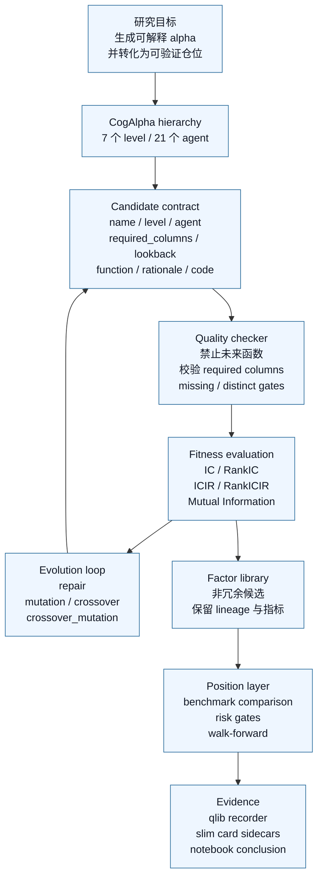
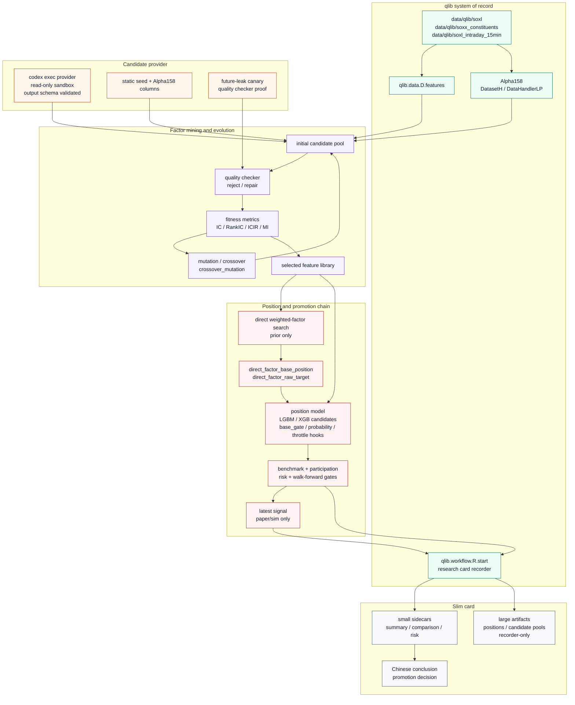
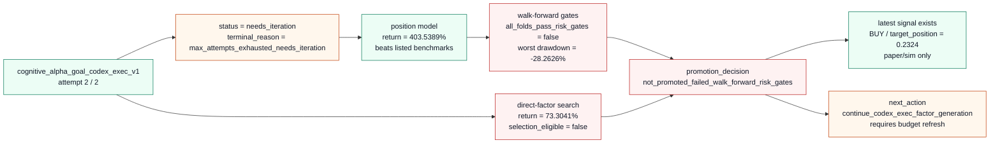

# Cognitive Alpha 架构对比

本文档说明 Cognitive Alpha 的目标架构，与当前 SOXL qlib-native 项目中已经实现的方案之间的关系。它不是新的实验产物；当前状态以 `research/cognitive_alpha_goal_codex_exec_v1/summary.json`、`workflow.yaml`、`conclusion.md` 和对应 qlib recorder 为准。

## 依据

- 本仓库合同：`AGENTS.md`、`SPEC.md` 要求 notebook-first、recorder-first、slim-card，并要求数据、训练、回测和分析以 qlib 为系统入口。
- qlib 官方文档：[Data Layer](https://qlib.readthedocs.io/en/latest/component/data.html) 说明 qlib format、DataHandlerLP 和 DatasetH；[Workflow](https://qlib.readthedocs.io/en/latest/component/workflow.html) 说明 Data、Model、Evaluation 和 execution tracking；[Model](https://qlib.readthedocs.io/en/latest/component/model.html) 文档示例使用 `qlib.init`、`DatasetH`、`R.start`、`SignalRecord`；[API Reference](https://qlib.readthedocs.io/en/latest/reference/api.html) 列出 `SignalRecord`、`SigAnaRecord`、`PortAnaRecord` 等 recorder template。
- 当前实现入口：`src/factor/cognitive_alpha.py`、`src/factor/cognitive_alpha_mining.py`、`src/workflow/cognitive_alpha_evolution.py`、`src/workflow/cognitive_alpha_goal.py`、`src/workflow/cognitive_alpha_goal_codex_exec.py`、`src/workflow/cognitive_alpha_position.py`、`src/workflow/cognitive_alpha_weighted.py`。

## Cognitive Alpha 目标架构

目标形态不是让 LLM 直接给交易指令，而是把多 agent 的研究假设压成可执行、可审计的 alpha candidate，再经过质量、统计、相关性、仓位和 walk-forward 风险门禁。能不能晋升取决于 recorder-backed 证据，不取决于候选生成看起来是否合理。

## 当前项目实现

当前实现已经把 Cognitive Alpha 的候选生成、质量检查、演化、因子库、direct-factor prior、position model、walk-forward gates 和 recorder/card 证据链串起来。当前问题不是“没有架构”，而是最新 goal card 仍未通过晋升门。

## 对比表

| 维度 | Cognitive Alpha 目标 | 当前项目实现 | 当前判断 |
| --- | --- | --- | --- |
| 数据系统 | 统一、可复现、无未来函数的数据入口 | qlib provider + `D.features` + Alpha158 `DatasetH` / `DataHandlerLP` | aligned |
| 候选生成 | 多 agent 按经济含义生成 alpha idea | `COGALPHA_AGENT_LEVELS` 定义 7 个 level / 21 个 agent；Codex exec provider 用 schema 生成候选 | partial |
| 候选合同 | 候选必须可执行、可解释、可审计 | `CognitiveAlphaCandidate` 记录 `required_columns`、`lookback`、`economic_rationale`、`code` | aligned |
| 质量门 | 禁止未来函数、坏数据和不可执行表达式 | `quality_checker` 拒绝 `shift(-n)` / future `Ref`，并支持 repair loop 与 canary | aligned |
| 统计评价 | 不只看收益，要先看信号质量 | IC、RankIC、ICIR、RankICIR、Mutual Information、相关性去冗余 | aligned |
| 自主迭代 | 能基于失败反馈继续尝试 | Goal runner 支持 attempt、resume、state、feedback context 和 `needs_iteration` | partial |
| direct-factor | 作为可解释先验，而不是最终晋升捷径 | `cognitive_alpha_weighted_factor_search` 输出 base position 和 raw target，并接入 position frame | aligned |
| 仓位模型 | alpha 必须转化为仓位并通过风险门 | LGBM/XGB position candidates、benchmark comparison、participation gates、walk-forward gates | partial |
| 证据形态 | recorder-first，根目录只保留小 sidecar | `summary.json` 记录 `slim_card_recorder_first`，positions/candidate pools 等大产物在 recorder | aligned |
| 生产边界 | 未晋升前不得当作实盘策略 | 只生成 paper/sim signal；真实 broker 下单不在 v1 范围内 | blocked |

## 最新证据状态

当前结论：

- 架构实现状态：`partial`，核心链路已实现并有 recorder/card 证据。
- 晋升状态：`blocked`，因为 latest goal card 为 `needs_iteration`，最终 `promotion_decision=not_promoted_failed_walk_forward_risk_gates`。
- direct-factor 状态：`prior_only_not_final_promotion`，不能把 direct-factor 结果当作生产晋升依据。
- 下一步应继续扩展 Codex exec 候选和稳定性筛选，重点修复 walk-forward 风险门，而不是重写 qlib 证据链或绕过 recorder。
