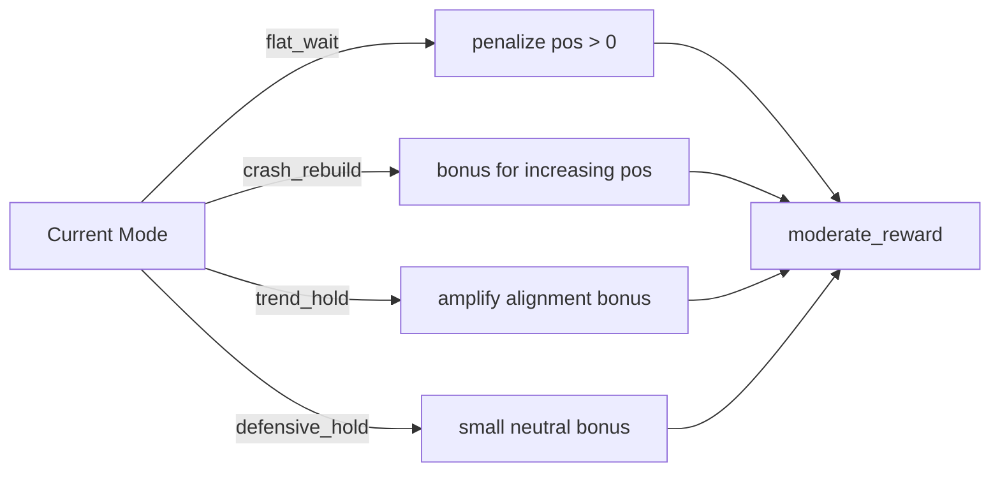

# risk_budget_usage_v2

**方向**: model
**类别**: risk_budget
**状态**: 🟡 Experimental

## 假设

在 v1 基础上引入两个互补扩展，引导 PPO 发现更少保守的策略：
1. **Mode-Conditional Reward**: 将 mode 语义直接编码到 reward 中
2. **Dynamic Band Scaling**: 根据 realized_vol 实时缩放 risk band

## 方法/配置

Profile: `risk_budget_usage_v2`
网络: GRU-64 + [128,64] MLP

## 架构

继承 v1 的完整架构，在以下两层增强：

### Mode-Conditional Reward Shaping



### Dynamic Band Scaling

```
realized_vol ──→ scale = 1.0 - (vol - 0.50) × 0.30
                    scale = clamp(scale, 0.60, 1.20)
original_band ──→ new_band = centre ± (width × scale / 2)
```

## 与 v1 的差异

| 维度 | v1 | v2 |
|------|-----|-----|
| Mode reward | ❌ | ✅ flat_wait/crash_rebuild/trend_hold/defensive_hold 条件奖励 |
| Dynamic bands | ❌ | ✅ 基于 realized_vol_10 动态缩放 |
| 目标 Sharpe | 0.942 | ≥ 0.95 |
| 目标 2022 MaxDD | 18.7% | ≤ 20.0% |

## 结果

| 切片 | Return | Sharpe | MaxDD | AvgPos | StressAvgPos |
|------|--------|--------|-------|--------|-------------|
| test_proxy | 158.3% | **0.884** | 20.6% | 0.180 | 0.070 |
| test_2020 | 27.7% | 1.515 | 16.7% | 0.210 | 0.097 |
| test_2022 | -3.2% | -0.272 | **7.4%** | **0.070** | 0.035 |
| test_2023_2024 | 40.1% | 1.227 | 15.4% | 0.179 | 0.098 |
| valid | 12.7% | 0.795 | 17.1% | 0.255 | 0.095 |

### 与 v1 对比

| 指标 | v1 | v2 | 变化 |
|------|-----|-----|------|
| proxy Sharpe | 0.942 | 0.884 | ↓ 未达 0.95 目标 |
| proxy MaxDD | 32.5% | 20.6% | ↓ 改善 |
| 2022 MaxDD | 18.7% | 7.4% | ↓ 显著改善 |
| 2022 avg_pos | 0.127 | 0.070 | ↓ 更保守 |
| 2020 Return | 40.9% | 27.7% | ↓ 下降 |
| 2023-24 Return | 82.8% | 40.1% | ↓ 下降 |

## 结论

**Keep as candidate, parameter tuning needed.**

v2 的 mode-conditional reward + dynamic band scaling 让策略显著更保守：
- ✅ 2022 MaxDD 从 18.7% → 7.4%（极端优秀）
- ❌ proxy Sharpe 从 0.942 → 0.884（未达 0.95 目标）
- ❌ 2020/2023-2024 回报下降（过度保守，错失参与机会）

**诊断**: `flat_wait_pos_penalty=0.15` 可能太强，导致 flat_wait 模式下过度空仓。

## 实验原始记录

详细配置、动机和迭代历史见：
- `experiments/candidate/risk_budget_usage_v2/notes.md`
- `experiments/candidate/risk_budget_usage_v2/expectations.md`
- `experiments/candidate/risk_budget_usage_v2/profile.yaml`

## 下一步

- 降低 `flat_wait_pos_penalty`（如 0.15 → 0.08）或提高 `crash_rebuild_bonus`
- 重新训练 v2-tuned，验证 Sharpe 是否回升到 0.95+
