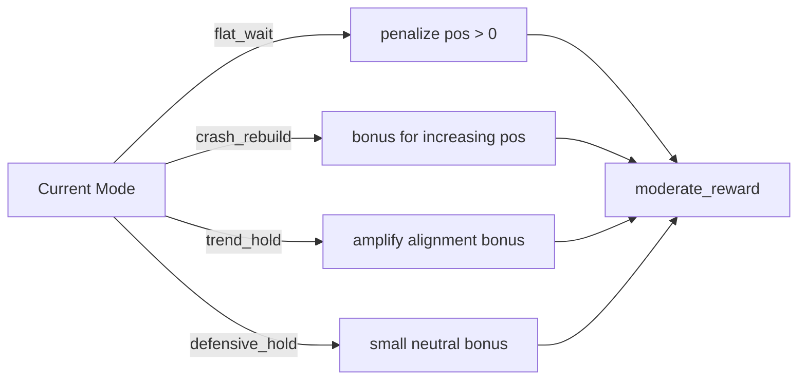

# risk_budget_usage_v2

**方向**: model
**类别**: risk_budget
**状态**: 🟡 Experimental

## 假设

在 v1 基础上引入两个互补扩展，引导 PPO 发现更少保守的策略：
1. **Mode-Conditional Reward**: 将 mode 语义直接编码到 reward 中
2. **Dynamic Band Scaling**: 根据 realized_vol 实时缩放 risk band

## 方法/配置

Profile: `risk_budget_usage_v2`
网络: GRU-64 + [128,64] MLP

## 架构

继承 v1 的完整架构，在以下两层增强：

### Mode-Conditional Reward Shaping



### Dynamic Band Scaling

```
realized_vol ──→ scale = 1.0 - (vol - 0.50) × 0.30
                    scale = clamp(scale, 0.60, 1.20)
original_band ──→ new_band = centre ± (width × scale / 2)
```

## 与 v1 的差异

| 维度 | v1 | v2 |
|------|-----|-----|
| Mode reward | ❌ | ✅ flat_wait/crash_rebuild/trend_hold/defensive_hold 条件奖励 |
| Dynamic bands | ❌ | ✅ 基于 realized_vol_10 动态缩放 |
| 目标 Sharpe | 0.942 | ≥ 0.95 |
| 目标 2022 MaxDD | 18.7% | ≤ 20.0% |

## 结果

(TBD — 训练完成后填写)

## 实验原始记录

详细配置、动机和迭代历史见：
- `experiments/candidate/risk_budget_usage_v2/notes.md`
- `experiments/candidate/risk_budget_usage_v2/expectations.md`
- `experiments/candidate/risk_budget_usage_v2/profile.yaml`

## 下一步

- 运行训练并验证指标
- 对比 v1 的 replay 路径和 actor-backed 结果
